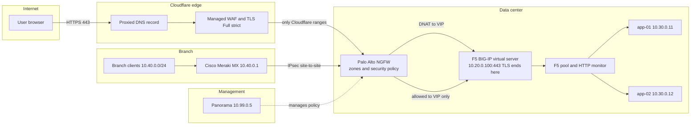
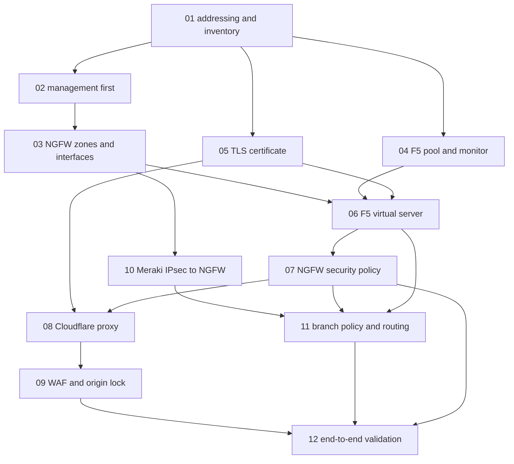

# Architecture of the digital network twin

How the components fit together and why they depend on one another. Use it alongside the stages.

## What a digital twin is here

The twin is a model of the production-like path, built one fact at a time. Each configuration stage produces facts: an address plan, a pool, a certificate, a rule. A later stage can run only when the facts it depends on exist. The sequencing tool enforces that rule, so the order you learn is the order a real engineer must follow.

The twin has no live devices. You learn the architecture by building it on paper and checking each step against its dependencies.

## The path, end to end

Read the diagram as three rules:

1. Users reach the application only through the Cloudflare edge, and the origin accepts only the edge.
2. Every path into the data center crosses the Palo Alto NGFW, including the branch.
3. The F5 is the only route to the application pool. No client reaches an app server directly.

## Layers and responsibilities

| Layer | Vendor | Responsibility | Fails closed when |
|---|---|---|---|
| Edge | Cloudflare | Public DNS, reverse proxy, WAF, TLS to the origin | The origin is not locked, so traffic can bypass the edge |
| Perimeter | Palo Alto NGFW | Zones, default-deny policy, NAT, IPsec hub | Rules are placed in the wrong order, or the default-deny rule is missing |
| Delivery | F5 BIG-IP LTM | Virtual server, TLS termination, pool selection, health checks | The pool has no healthy member, or TLS terminates in the wrong place |
| Application | synthetic app | The workload behind the delivery layer | Not applicable in this lab; it is the protected asset |
| Branch | Cisco Meraki MX | Branch gateway, IPsec spoke, branch rules | The route into the tunnel is missing, or the branch firewall allows too much |
| Management | Palo Alto Panorama | Central policy and logs for the NGFW | Management is reachable from the internet |

The management layer is shown with a dotted line because it manages policy but does not carry user traffic. That separation is why stage 02 locks management before any data path exists.

## Addressing plan

| Name | Address | Zone | Purpose |
|---|---|---|---|
| Origin (NGFW untrust) | 198.51.100.2/24 | untrust | Target of the Cloudflare proxy |
| NGFW DMZ | 10.20.0.2/24 | dmz | Next hop to the F5 |
| F5 self-IP | 10.20.0.10/24 | dmz | BIG-IP address for health checks and SNAT |
| F5 virtual server | 10.20.0.100:443 | dmz | The application's delivery address |
| App members | 10.30.0.11, 10.30.0.12 | app | Pool members |
| Branch MX WAN | 198.51.100.40/24 | branch WAN | IPsec peer address |
| Branch LAN | 10.40.0.0/24 (gateway 10.40.0.1) | branch | Branch clients |
| Panorama | 10.99.0.5/24 | management | Policy management only |
| Branch tunnel | 10.50.0.0/30 | vpn-branch | IPsec tunnel interface on the NGFW |

The F5 and the pool are in different zones, so the F5's health checks and proxied requests cross the NGFW from `dmz` to `app`. Stage 07 therefore needs an explicit rule for the F5 self-IP to the pool port, and the default-deny rule would break the application without it. A security rule matches the pre-NAT destination address but the post-NAT zone, which is why the edge rule names `198.51.100.2` and zone `dmz`.

The lab uses RFC 5737 documentation ranges for public-looking addresses and RFC 1918 ranges for private ones. Do not replace them with real addresses.

## Design decisions

### Why IPsec, not Auto VPN, between the branch and the hub

Cisco Meraki Auto VPN connects Meraki MX appliances to each other. The hub here is a Palo Alto NGFW, which is not a Meraki device, so the branch MX is configured as a non-Meraki VPN peer that uses standard IKEv2 and IPsec. Choosing the right mechanism is an architecture decision, and getting it wrong is a design error, not a configuration typo.

### Why the NGFW sits between the edge and the F5

The Cloudflare WAF inspects requests for web attacks, but it does not enforce your internal zones or your rules for non-HTTP traffic. The NGFW keeps a second, independent control on the path: it allows only the edge's addresses on 443, logs everything, and denies the rest. Two controls that fail independently are stronger than one that fails alone.

### Why the F5 terminates TLS and the NGFW does not

The NGFW inspects traffic and enforces policy; it can decrypt in some designs, but this twin keeps decryption at the F5, where the certificate and the pool selection already live. The NGFW therefore sees encrypted traffic to the VIP. A design that needs inspection of decrypted traffic would move TLS termination to the NGFW, and that is a stated trade-off to record in an ADR.

### Why the origin is locked to Cloudflare

Without a lock, anyone who discovers the origin address can bypass the WAF. The lock is enforced twice: at the NGFW (source allowlist) and optionally at the origin with Authenticated Origin Pulls.

## Single points of failure

The reference design has one NGFW and one F5. Both are single points of failure, and this is the first question a reviewer will ask.

| Component | Failure impact | Mitigation to evaluate |
|---|---|---|
| NGFW | All north-south and branch traffic stops | HA pair with session sync; test failover |
| F5 | Application unreachable | HA pair with device-group sync; test failover |
| Branch MX | Branch loses data center access | Second WAN or a second tunnel; test failover |
| Cloudflare | Public access stops | Cloudflare is managed and multi-homed; record the provider's SLA and your own fallback |

The lab does not model these mitigations. Stage 12's failure drill tests only the pool member, not the devices.

## Sequence and dependencies

The sequence follows dependencies, not habit. The stage graph is:

The reason for each ordering is in the stage's own "Why" section. The most important ones are:

- Policy names the VIP, so the VIP exists first (06 before 07).
- The proxy goes live only after the origin allows the edge and presents a valid certificate (07 and 05 before 08).
- The branch path needs both the tunnel and the NGFW rule (10 and 07 before 11).

## Reading a failed verification

When a stage's verify step fails, check the stage's dependencies in this order: did the upstream fact exist, did it get applied in the expected state, and does the failing check depend on something outside this twin? Most failures are a missing dependency, not a bad setting. The sequencing tool shows the missing facts directly.

## What this twin cannot prove

- Vendor syntax and version-specific behavior.
- Performance, throughput, or capacity.
- License entitlement, subscription terms, or pricing.
- Real certificate issuance, DNS propagation, or Cloudflare's current published IP ranges.
- Real failover between devices, which needs a physical or virtual lab.

Name these explicitly in any design review. A clean sequence run proves the order is internally consistent, not that the production network is correct.
