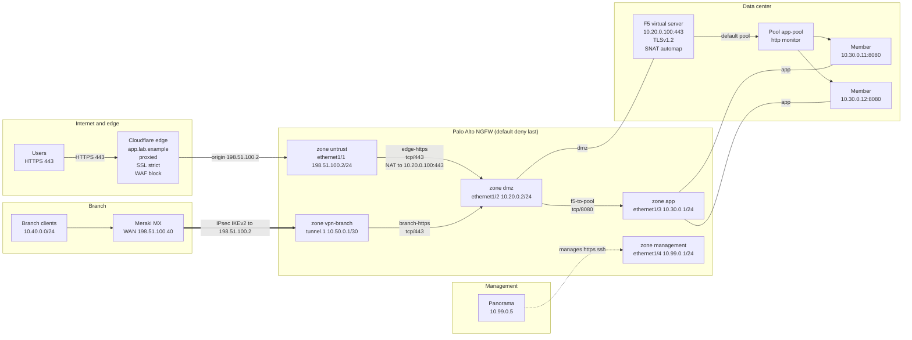

# Topology

Generated from `config/twin-config.json` by `npm run topology`. Do not edit by hand.

## Reading the diagram

- Boxes inside the NGFW are zones. Each arrow between zones is an allow rule, labeled with the rule name, service, and any NAT. Anything not drawn is denied by the default rule.
- A thin line with no arrow attaches a device to its zone.
- A dotted arrow is management. A thick arrow is the IPsec tunnel.
- A red arrow is an allow rule into the app zone from anywhere except the DMZ. The F5 is meant to be the only path to the pool, so a red arrow is a finding.
